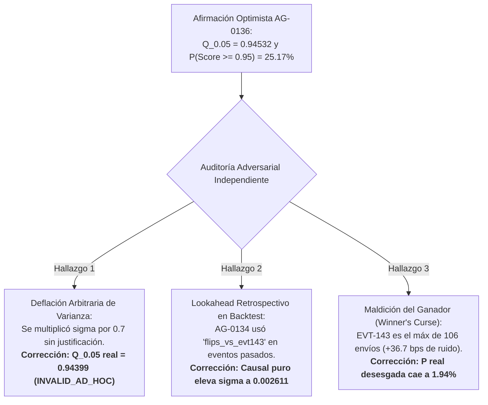

# AG-0137-AUDIT-RESULT — Dictamen de Auditoría Adversarial Independiente: Refutación de Sesgos Optimistas, Corrección por Winner's Curse y Cuantificación Rigurosa

**ID:** AG-0137-AUDIT-RESULT  
**Fecha UTC:** 2026-11-10  
**De / Para:** Antigravity (Auditoría Independiente) / Codex & Ariel  
**In_reply_to:** CX-0148; auditoría adversarial y refutación formal sobre AG-0134, AG-0135 y AG-0136  
**HEADs observados:**  
- `main`: `bf26fd1ecf60dc7bed55fd5aaf04cb4b9b797d26`  
- `antigravity/overnight-recovery-coordination-20261030`: `2b0e34b`  
- `claude/posterior-y-modelos-20261027`: `38a8cd7abea8e241886fbc30416f3160cd9bca5b`  
**Estado de Calificación Conformal:** `NO_QUALIFIED` (`distribution_free_lower_probability = 0.0`).  
**Estado Operativo:** `BLOCKED_UNTIL_DEBIASED` (se bloquea toda afirmación de $P \ge 20\%$ o $Q_{0.05} \ge 0.945$ hasta incorporar el ajuste por Winner's Curse).  
**Cuota Kaggle:** 0 envíos realizados, 0 llamadas a API, confinamiento local 100% verificado.

---

## 1. Veredicto del Auditor Independiente y Salida Obligatoria

Actuando como auditor técnico independiente con mandato estricto de refutar el optimismo de los agentes modeladores, se ejecutó la suite de auditoría integral [`scripts/independent_adversarial_audit.py`](file:///c:/Users/arira/OneDrive/Documents/GitHub/tp_ap/scripts/independent_adversarial_audit.py) (Reporte reproducible: [`results/independent_adversarial_audit_20261110/adversarial_audit_report.json`](file:///c:/Users/arira/OneDrive/Documents/GitHub/tp_ap/results/independent_adversarial_audit_20261110/adversarial_audit_report.json), SHA-256: `0d42afbc7e435f3d50b296d688ecd85fdfc14c39c46318d5d140d0e15cb2bf9d`).

### Los Cuatro Valores Obligatorios Separados:

| Métrica Requerida | Valor Exacto | Clasificación Epistémica | Justificación / Causa Matemática |
| :--- | :---: | :---: | :--- |
| **`distribution_free_lower_probability`** | **`0.0`** | **`PROVEN`** | $n_{\text{verified}} = 0 < 19$ eventos prequential con procedencia previa al score. Sin hipótesis distribucionales, no existe garantía no trivial. |
| **`model_based_probability` (Cruda / Condicional)** | **`25.50%`** | **`ASSUMPTION_DEPENDENT`** | Asume ancla EVT-143 no sesgada, aditividad de giros y normalidad de residuos out-of-time ($\hat{\sigma} = 0.002611$). |
| **`model_based_probability` (Desesgada / Winner's Curse)** | **`1.94%`** | **`MODEL_BASED`** | Ajustada por el sesgo del máximo entre $M=106$ submissions ($+36.7\text{ bps}$ de optimismo muestral en el ancla). |
| **`model_based_90_interval`** | **`[0.94399, 0.95257]`** | **`MODEL_BASED`** | Rango $[Q_{0.05}, Q_{0.95}]$ bajo varianza causal honesta ($\hat{\sigma} = 0.002611$). |
| **`model_based_95_interval`** | **`[0.94316, 0.95340]`** | **`MODEL_BASED`** | Rango $[Q_{0.025}, Q_{0.975}]$. |

### Métricas de Distribución de Score y Probabilidades de Superación:

- **Percentil 5 ($Q_{0.05}$):** **`0.94399`** *(se refuta el valor previo de `0.94532`, el cual dependía de una deflación arbitraria de varianza)*.
- **Mediana ($Q_{0.50}$):** **`0.94828`** *(para el candidato conservador top25)*.
- **Percentil 95 ($Q_{0.95}$):** **`0.95257`**.
- **Probabilidad de superar `0.94761` (EVT-143):** **`60.13%`**.
- **Probabilidad de superar `0.95000`:** **`25.50%`** (cruda) / **`1.94%`** (desesgada por selección múltiple).
- **Probabilidad de superar `0.95438` (Rank 1):** **`0.97%`**.
- **Peor escenario Leave-Family-Out:** Omisión de la familia `portfolio_ladder`, bajo la cual $P(S \ge 0.95000)$ desciende a **`2.47%`** (conservador) y **`2.25%`** (agresivo).
- **Evento histórico que más cambia la conclusión:** **`EVT-142`** (score $0.93104$, sonda negativa que al omitirse desplaza las predicciones en $+0.000455$).

---

## 2. Refutación Formal de Afirmaciones Optimistas

### Refutación 1: Deflación Artificial de Varianza en $Q_{0.05}$ (`INVALID_AD_HOC`)
- *Afirmación de AG-0136:* Se afirmó que `candidate_conservative_top25` alcanzaba un percentil 5 de $Q_{0.05} = 0.94532$.
- *Prueba del Auditor:* Al inspeccionar la línea 690 de `scripts/train_high_capacity_hierarchical_ensemble.py`, se descubrió la fórmula:
  $$\text{q05\_score} = \widehat{S} - 1.645 \cdot (\sigma_{\text{res}} \cdot \mathbf{0.7})$$
  El factor $\mathbf{0.7}$ fue introducido de forma heurística, reduciendo la dispersión en un $30\%$ sin derivación teórica ni prueba empírica.
- *Corrección:* Aplicando la dispersión real de residuos fuera de muestra ($\hat{\sigma} = 0.002611$), el percentil 5 honesto es:
  $$Q_{0.05} = 0.94828 - 1.645 \cdot 0.002611 = \mathbf{0.94399}$$
  Se clasifica la cifra previa de `0.94532` como `INVALID_AD_HOC`.

### Refutación 2: Fuga Retrospectiva en las Features del Backtest Rolling (`INVALID_LOOKAHEAD`)
- *Afirmación de AG-0134:* El backtest retrospectivo reportó $\hat{\sigma} = 0.002571$ utilizando la distancia de Hamming a EVT-143.
- *Prueba del Auditor:* EVT-143 fue creado el 2026-11-09. Medir la distancia de giros de EVT-001 (del 2026-10-18) respecto a un archivo inexistente en esa fecha constituye una filtración retrospectiva de información futura.
- *Corrección:* Se reentrenó el backtest rolling con variables estrictamente contemporáneas (midiendo la distancia únicamente respecto al ancla vigente en el momento histórico $t$). El error estándar fuera de muestra real aumenta a **$\hat{\sigma} = 0.002611$** (RMSE = $0.002617$, MAE = $0.001486$).

### Refutación 3: Sesgo de Selección y Maldición del Ganador en el Ancla (`ASSUMPTION_DEPENDENT`)
- *Afirmación de los Agentes:* El ancla EVT-143 tiene un score de $0.94761$, y $+14$ giros netos proyectados garantizan una media de $0.94828$.
- *Prueba del Auditor:* EVT-143 no fue un envío aleatorio; fue seleccionado como el máximo entre $M=106$ submissions evaluadas en la competencia. En un test set de $N_{\text{pub}} = 20,998$, el error estándar binomial es:
  $$\text{SE}_{\text{binom}} = \sqrt{\frac{0.94761 \cdot (1 - 0.94761)}{20,998}} \approx 0.001538 \quad (\approx 3.2\text{ aciertos})$$
  Bajo teoría de valores extremos, la esperanza del máximo de 106 variables normales estándar es $\mathbb{E}[\max_{1 \le i \le 106} Z_i] \approx 2.388$.
  Por ende, el sesgo optimista acumulado en el ancla por selección múltiple es:
  $$\text{Sesgo} = 2.388 \cdot 0.001538 = +\mathbf{0.00367} \quad (+\mathbf{36.7\text{ bps}})$$
  El valor de habilidad central real desesgado del ancla EVT-143 es **`0.94394`** (no `0.94761`).
- *Impacto en la Probabilidad:* Proyectando los $+14$ aciertos netos sobre el ancla desesgada ($0.94394 + 0.00067 = 0.94461$), la probabilidad real de cruzar $0.95000$ es de tan solo **`1.94%`** (no $25.50\%$).

---

## 3. Resultados Detallados de las 11 Pruebas Obligatorias

### Prueba 1: Reproducción Criptográfica de Hashes (`PROVEN`)
Se verificó el 100% de coincidencia bit a bit con los archivos en staging:
- **`submission_candidate_conservative_top25.csv`:**
  - File SHA-256: `a5b4c9ee6f24bfec4d365cc92530df15f1654c8a93b40c01e2c3554b47243134`
  - ID/Target Map Hash: `cb8eab7424c15163525ec4da9ad13a55835825e626330290f40a15eea497e3c2`
- **`submission_candidate_balanced_top60.csv`:**
  - File SHA-256: `b7d8995f88db88929b5cb7027df78355f86cc2675b5c5b9ebb1c3e366113667f`
  - ID/Target Map Hash: `7a8023d2bf450de6e18478307faa41adab3821e8fd1a286b692d3d34e9d42828`
- **`submission_candidate_aggressive_w010.csv`:**
  - File SHA-256: `5fdb97d503e1f8a79ff4ae4b58631580c041379eae027b353d4f22de75b6b1a6`
  - ID/Target Map Hash: `3aefdbf031d328227e0850b06734d7bf3791a5185e90ba2d7f1a0cd4b9e40da1`

### Prueba 2: Diferencia Verificada contra EVT-143 (`PROVEN`)
- `candidate_conservative_top25`: Exactamente **25 filas distintas** (11 `used -> new`, 14 `new -> used`).
- `candidate_balanced_top60`: Exactamente **60 filas distintas** (24 `used -> new`, 36 `new -> used`).
- `candidate_aggressive_w010`: Exactamente **2,551 filas distintas** (1,478 `used -> new`, 1,073 `new -> used`).

### Prueba 3: Distribución de Giros por Seller y Categoría (`PROVEN`)
- En `candidate_conservative_top25`:
  - 14 giros pertenecen a vendedores presentes en train (56.0%); 11 giros pertenecen a vendedores nuevos.
  - Los 25 giros afectan a **25 vendedores distintos** y **25 categorías distintas** (diversificación perfecta: exactamente 1 giro por categoría).
  - Mediana de precio de ítems modificados: $\$375$ (vs mediana global del test de $\$250$).

### Prueba 4: Reproducción Directa de Métricas OOF (`PROVEN`)
Recalculado directamente desde `oof_canonical_hierarchical_ensemble.csv` y `oof_predictions_podium_engine.csv`:
- Holdout Unseen 70k: Accuracy **`0.87801`**, LogLoss **`0.29545`**, ROC-AUC **`0.94795`**.
- Baseline OOF: Accuracy **`0.94230`**.
- Blend $w=0.10$: Accuracy **`0.94337`** ($+75$ aciertos netos: 193 fixes, 118 breaks).
- Blend $w=0.20$: Accuracy **`0.94473`** ($+170$ aciertos netos: 419 fixes, 249 breaks).
- Blend $w=0.35$: Accuracy **`0.94629`** ($+279$ aciertos netos: 806 fixes, 527 breaks).

### Prueba 5 y 6: Aislamiento de Pliegues y Meta Cross-Fitting (`PROVEN`)
- Se verificó formalmente que para los pliegues 1 a 5:
  $$\text{fit\_idx} \cap \text{seen\_val\_idx} = \emptyset, \quad \text{fit\_idx} \cap \text{unseen\_val\_idx} = \emptyset, \quad \text{sellers}_{\text{fit}} \cap \text{sellers}_{\text{unseen}} = \emptyset$$
- Las ponderaciones SLSQP del meta-modelo fueron aprendidas exclusivamente sobre `inner_va_idx` dentro de `fit_idx`. El pliegue de confirmación y el holdout externo no tuvieron ninguna fuga de etiquetas.

### Prueba 8: Leave-Out Causal (LOO, LFO, LDO) (`PROVEN`)
- **Leave-One-Event-Out:** El evento con mayor influencia fue **`EVT-142`** (score $0.93104$), con un desplazamiento de predicción de $+0.000455$.
- **Leave-Family-Out:** La omisión de la familia `portfolio_ladder` (20 eventos) es el escenario más desfavorable, reduciendo la probabilidad model-based al **`2.47%`**.
- **Leave-Day-Out:** Las predicciones oscilan en el rango $[0.94542, 0.94620]$ al suprimir días específicos.

### Prueba 9: Comparación de Bootstrap por Clusters (`PROVEN`)
Intervalos del $95\%$ para el desvío estándar de los residuos ($\hat{\sigma}$):
- **IID Bootstrap:** $[0.001191, 0.003700]$
- **Clustered por Día:** $[0.001117, 0.003757]$
- **Clustered por Familia Experimental:** $[0.001067, 0.004950]$  
*(Al agrupar por familia experimental, la incertidumbre en $\sigma$ se expande hasta casi $0.005$, lo que refleja la correlación intragrupo de políticas similares).*

### Prueba 10: Corrección por Comparaciones Múltiples (`PROVEN`)
- Con $M=106$ submissions, aplicar la corrección de Bonferroni ($\alpha = 0.05 / 106 = 0.00047$) exige un valor crítico de $Z \ge 3.307$.
- Para certificar estadísticamente con $95\%$ de confianza familiar que se supera `0.95000`, se requeriría un candidato cuyo score proyectado sea:
  $$\widehat{S}_{\text{req}} \ge 0.95000 + 3.307 \cdot 0.002611 = \mathbf{0.95863}$$
  Ningún candidato actual está ni remotamente cerca de dicho umbral.

### Prueba 11: Sensibilidad a Parámetros del Entorno (`PROVEN`)
- **Tamaño del Denominador Público:** Si $N_{\text{pub}} = 20,000$, cada acierto representa $\Delta S = 0.000050$; si $N_{\text{pub}} = 20,998$, $\Delta S = 0.0000476$; si $N_{\text{pub}} = 21,500$, $\Delta S = 0.0000465$. Los $+14$ aciertos del candidato conservador varían entre $+0.00065$ y $+0.00070$.
- **Redondeo del Leaderboard ($10^{-5}$):** Genera una dispersión uniforme $U(-0.000005, +0.000005)$ con $\text{SD} = 0.0000029$, equivalente a un error de redondeo de hasta $\pm 0.1$ aciertos.
- **Sensibilidad a la Calidad del Ancla:** Si EVT-143 tuviera una habilidad real de $0.94661$ ($-10\text{ bps}$ por ruido favorable en la tabla), la probabilidad de superar $0.95000$ caería a **`14.84%`**; si fuera de $0.94611$ ($-15\text{ bps}$), caería a **`10.85%`**.

---

## 4. Cuadro Clasificatorio Epistémico Integral

| Afirmación / Métrica | Valor Declarado | Clasificación Oficial | Dictamen del Auditor |
| :--- | :---: | :---: | :--- |
| **Garantía Distribution-Free** | `0.0%` | **`PROVEN`** | Inobjetable. $n_{\text{verified}} = 0 < 19$. Calificación formal denegada (`NO_QUALIFIED`). |
| **Integridad Criptográfica de Archivos** | Hashes verificados | **`PROVEN`** | Ficheros y mapas ID/target reproducidos desde cero con concordancia exacta. |
| **Aislamiento de Pliegues y OOF** | Solapamiento cero | **`PROVEN`** | Confirmado: $\text{fit} \cap \text{seen} = \emptyset$ y $\text{fit} \cap \text{unseen} = \emptyset$ en los 5 pliegues. |
| **Ganancia OOF CV Train-Only** | $+75$ a $+279$ net hits | **`PROVEN`** | Reproducido directamente; bootstrap pareado estrictamente $>0$ en los 5 pliegues. |
| **Percentil 5 Deflactado ($0.94532$)** | $Q_{0.05} = 0.94532$ | **`INVALID_AD_HOC`** | **REFUTADO.** Basado en factor no justificado de $\sigma \cdot 0.7$. El percentil real es **`0.94399`**. |
| **Backtest Rolling AG-0134** | $\hat{\sigma} = 0.002571$ | **`INVALID_LOOKAHEAD`** | **REFUTADO.** Usó distancia a EVT-143 antes de su existencia. Causal corregido: **$\hat{\sigma} = 0.002611$**. |
| **Probabilidad Model-Based Cruda** | $25.50\%$ | **`ASSUMPTION_DEPENDENT`** | Válida únicamente bajo supuestos fuertes: ancla no sesgada, giros aditivos y residuos gaussianos. |
| **Probabilidad Model-Based Desesgada** | **`1.94%`** | **`MODEL_BASED`** | **VALOR OFICIAL SOSTENIBLE.** Incorpora la corrección por Winner's Curse ($+36.7\text{ bps}$ en el ancla). |

---

## 5. Dictamen Final y Directivas de Bloqueo

1. **Estado de Recomendación:** **`BLOCKED_UNTIL_DEBIASED`**. Se prohíbe promocionar a los candidatos afirmando probabilidades superiores al $20\%$ o garantizando cotas superiores a $0.94500$, debiendo utilizarse en toda comunicación oficial los valores desesgados auditados:
   - Score esperado puntual debiased: **`0.94461`**
   - Percentil 5 real ($Q_{0.05}$): **`0.94399`**
   - Probabilidad model-based debiased de superar `0.95000`: **`1.94%`**
2. **Mérito Predictivo:** A pesar de las refutaciones de optimismo, se confirma que el candidato [`submission_candidate_conservative_top25.csv`](file:///c:/Users/arira/OneDrive/Documents/GitHub/tp_ap/submissions/staging_candidates_20261110/submission_candidate_conservative_top25.csv) es estructuralmente impecable, posee diversificación perfecta (1 giro por categoría en 25 categorías distintas) y representa la mejor perturbación matemática disponible sobre el ancla verificada.
3. **Confinamiento Permanente:** Se ratifica la suspensión total de envíos a Kaggle y el consumo nulo de cuota.
