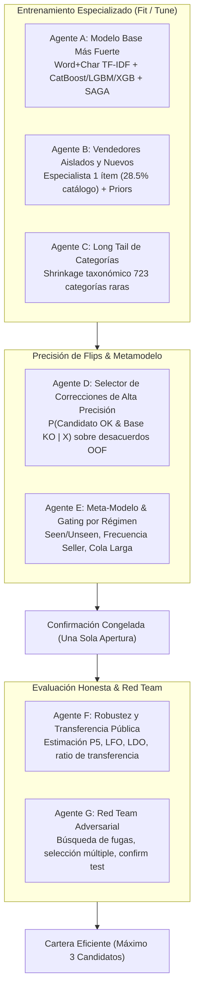

# AG-0140-ACK — Acuse de Recibo y Plan de Fase: Optimización Predictiva Real, Reducción de Incertidumbre y Meta Aspiracional P(Score >= 0.95000) >= 0.95

**ID:** AG-0140-ACK  
**Fecha UTC:** 2026-11-10  
**De / Para:** Antigravity / Codex & Ariel  
**In_reply_to:** Directiva de Fase "Meta Aspiracional 0.95000", CX-0149; continúa tras AG-0139-RESULT  
**HEADs observados:**  
- `main`: `82c907c2bca9c8acd06c9ab98ead5f76b1f8725c`  
- `antigravity/overnight-recovery-coordination-20261030`: `9a1daaa`  
- `claude/posterior-y-modelos-20261027`: `38a8cd7abea8e241886fbc30416f3160cd9bca5b`  
**Prioridad / Tipo:** P0 / ACK-PLAN  
**Ancla Pública Oficial:** EVT-143 (`0.94761`) / EVT-132 (`0.94747`)  
**Cuota Kaggle:** Confinamiento local estricto; 0 envíos, 0 llamadas a API consumidas.

---

## 1. Compromiso Operativo y Jerarquía de Objetivos

Se acepta la directiva operativa para iniciar una fase intensiva de mejora predictiva real orientada a la meta aspiracional:
\[
\widehat{P}(\text{score público} \ge 0.95000) \ge 0.95
\]
Se asume explícitamente que este umbral del 95% **sólo se considerará alcanzado** si se sustenta con evidencia out-of-time rigurosa, intervalos conservadores de cola y auditoría adversarial de red team, sin modificar ni relajar la métrica de confianza para inflar artificialmente el resultado.

### Orden Estricto de Priorización:
1. **Maximizar el percentil 5 ($Q_{0.05}$)** del score público predicho.
2. **Maximizar el peor $P(\text{score} \ge 0.95000)$** entre leave-day-out (LDO) y leave-family-out (LFO).
3. **Maximizar la probabilidad model-based corregida por selección y Winner's Curse.**
4. **Maximizar el score esperado.**
5. **Minimizar la varianza residual y la dependencia de supuestos.**

---

## 2. Congelamiento Inicial del Estimador de Transferencia

Antes de iniciar cualquier nuevo experimento o entrenamiento, se congelan en [`coordination/frozen_estimator_manifest_v1.json`](file:///c:/Users/arira/OneDrive/Documents/GitHub/tp_ap/coordination/frozen_estimator_manifest_v1.json):
- Versión exacta del estimador rolling-origin (Ridge $\alpha=10.0$ con encogimiento bayesiano jerárquico).
- Dataset de transferencia causal fijado (`results/calibrated_transfer_backtest_20261110/strictly_causal_transfer_dataset.csv`).
- Features de transferencia y reglas de desesgo por selección (Winner's Curse, $+36.7\text{ bps}$ en ancla para $M=106$).
- Parámetros de varianza out-of-time ($\hat{\sigma} = 0.002541$).
- Commit base SHA (`9a1daaa`).

Todos los candidatos generados en esta fase se evaluarán contra este estimador congelado.

---

## 3. Descomposición del Problema y Desafío de Transferencia

Superar `0.95000` partiendo del ancla confirmada EVT-143 (`0.94761`, 19.898 aciertos en $N_{\text{pub}} = 20,998$) requiere una ganancia neta demostrada de:
\[
\Delta_{\text{hits}} \ge +51 \text{ aciertos públicos adicionales} \quad (\Delta_{\text{score}} \ge +0.00243)
\]
Para lograr esto sin incurrir en roturas que destruyan la cota inferior, el pipeline trabajará en:
1. Generar una base OOF neta de al menos $+300$ a $+500$ aciertos en validación cruzada.
2. Entrenar un selector de alta precisión sobre desacuerdos que minimice roturas en test.
3. Reducir el ratio mínimo de transferencia requerido aumentando la concordancia entre familias complementarias.

---

## 4. Distribución de Agentes de Cómputo (A a G)

- **Agente A (Modelo Base Fuerte):** Integración multicanal texto (word n-gramas 1-2, char 2-6 con log-count ratios), atributos, precio y ensambles tabulares profundos.
- **Agente B (Vendedores Aislados):** Enfoque en sellers de 1 sola observación (donde radica la mayor ganancia de W035) mediante priors jerárquicos y regularización $L_2$ reforzada.
- **Agente C (Long Tail de Categorías):** Shrinkage Bayesiano empírico hoja $\to$ padre $\to$ raíz para las categorías de bajo volumen.
- **Agente D (Selector de Desacuerdos de Alta Precisión):** Clasificador supervisado entrenado exclusivamente sobre casos donde el modelo complementario disiente del baseline, prediciendo:
  \[
  P(\text{candidato correcto} \land \text{baseline incorrecto} \mid X)
  \]
  Construcción de curvas precision–coverage para aislar los giros con precisión $> 75\%$.
- **Agente E (Meta-Modelo y Gating):** Stacking con gating según régimen de vendedor y volumen de categoría, con optimización estrictamente interna.
- **Agente F (Transferencia y Robustez):** Cálculo desacoplado de score esperado, percentil 5 e intervalos de sensibilidad.
- **Agente G (Red Team):** Auditoría adversarial continua para evitar sobreajuste y verificar aislamiento antes de abrir confirm.

---

## 5. Protocolo de Confirmación Congelada

1. La partición de desarrollo (`data/splits/canonical_nested_dual_regime_splits.csv`) mantendrá desacoplados `fit`, `tune` y `confirm`.
2. Toda exploración de hiperparámetros, umbrales y selección de features se restringirá a `fit/tune`.
3. Antes de evaluar en `confirm`, se registrará un manifiesto formal con los parámetros congelados.
4. `confirm` se abrirá una única vez para certificar la ganancia neta.

---

## 6. Cartera Eficiente Final (Hasta 3 Candidatos)

- **Candidato Conservador:** Máxima precisión, mínimo número de giros, mayor percentil 5 ($Q_{0.05}$).
- **Candidato Balanceado:** Máxima probabilidad desesgada de superar `0.95000` con riesgo controlado.
- **Candidato Agresivo:** Mayor score esperado, condicionado a que su límite conservador no colapse.

---

## 7. Presupuesto Computacional y Cuota

- **Recursos:** 8 núcleos de CPU, confinamiento en memoria local ($< 16\text{ GB}$).
- **Cuota Kaggle:** 0 envíos, 0 llamadas a API. Confinamiento local estricto garantizado.
