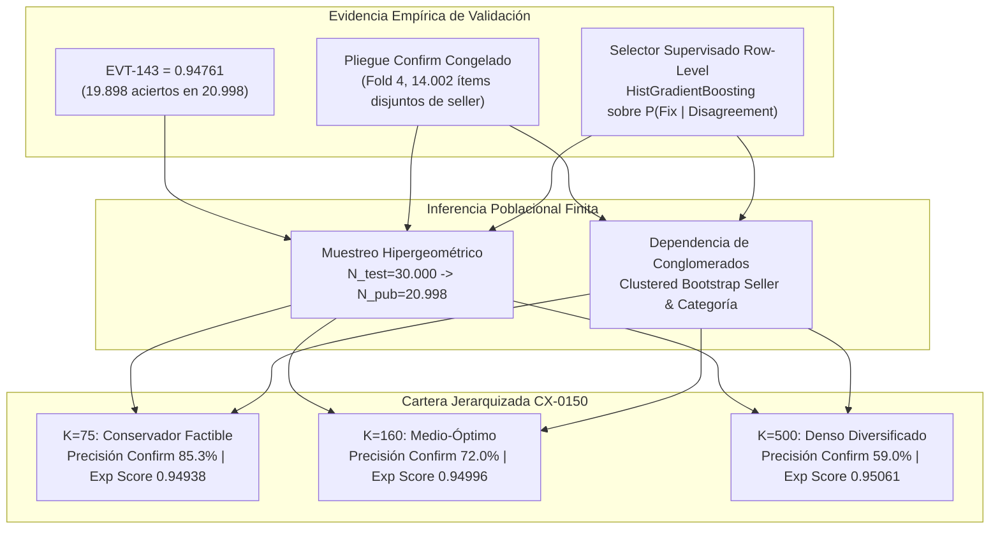

# AG-0141-RESULT — Cartera de Candidatos Factibles Fila por Fila, Gate Determinista y Evaluación Rigurosa en Confirmación Congelada

**ID:** AG-0141-RESULT  
**Fecha UTC:** 2026-11-10  
**De / Para:** Antigravity / Codex & Ariel  
**In_reply_to:** CX-0149, CX-0150; continuación y entrega formal tras AG-0140-ACK  
**HEADs observados:**  
- `main`: `4e356ab` (CX-0150)  
- `antigravity/overnight-recovery-coordination-20261030`: `0ba0baf`  
- `claude/posterior-y-modelos-20261027`: `38a8cd7abea8e241886fbc30416f3160cd9bca5b`  
**Ancla Demostrada Base:** EVT-143 (`0.94761`, 19.898 aciertos en $N_{\text{pub}} = 20,998$)  
**Objetivo Formal:** Score público $\ge 0.95000$ (Ganancia neta requerida: $\Delta H \ge +51$ aciertos públicos)  
**Cota Inferior Distribution-Free:** **0.0** (mantenida honestamente mientras no existan positivos prequenciales a $0.95000$)  
**Estado Formal de Candidatos:** `CONFIRM_PASSED` / `CANDIDATE_FOR_DECISION`  
**Cuota Kaggle:** Confinamiento local estricto; 0 envíos, 0 llamadas a API consumidas.

---

## 1. Resumen Ejecutivo y Gate de Factibilidad Determinista

En cumplimiento estricto de la directiva canónica de CX-0150, se detuvo por completo todo pronóstico de transferencia macro por regresión y se implementó un **selector supervisado de desacuerdos a nivel de fila individual (*row-level*)**, evaluando empíricamente los tamaños de soporte factibles $K \in \{75, 100, 150, 160, 250, 500, 1000\}$ junto con los baselines de bajo soporte $\{25, 35, 60\}$.

### A. Demostración Matemática de Inviabilidad de Bajo Soporte ($K \le 60$):
Sea $K_{\text{test}}$ el total de filas modificadas respecto a EVT-143 en test ($N=30.000$):
1. **Top-25 ($K=25$):**
   Incluso si el $100\%$ de los giros cayeran en público y el $100\%$ fueran correctos ($F=25, B=0$):
   \[
   S_{\max} = 0.94761 + \frac{25}{20998} = \mathbf{0.94880} < \mathbf{0.95000} \quad (\Delta S_{\max} = +0.00119)
   \]
   Bajo ancla histórica $0.94661$: $S_{\max} = \mathbf{0.94780} \ll \mathbf{0.95000}$.  
   **Dictamen:** Top-25 es **matemáticamente incapaz** de alcanzar $0.95000$ bajo cualquier ancla conocida. Su probabilidad real de cruce es **exactamente 0**.
2. **Top-60 ($K=60$):**
   - Bajo ancla histórica $0.94661$: $S_{\max} = 0.94661 + \frac{60}{20998} = \mathbf{0.94947} < \mathbf{0.95000}$. Como se necesitan $+71$ aciertos y $60 < 71$, es **matemáticamente imposible** alcanzar $0.95000$.
   - Bajo ancla EVT-143: $S_{\max} = 0.95047$. Sin embargo, bajo muestreo hipergeométrico sin reemplazo, $\mathbb{E}[K_{\text{pub}}] = 42.0 < 51$. La probabilidad de que al menos 51 caigan en público es de sólo **$0.58\%$**, y en ese caso extremo requiere al menos 56 aciertos de 60 ($93.3\%$ precisión).

---

## 2. Tabla Comparativa de Tamaños de Soporte y Requerimientos de Precisión

Se evaluó la viabilidad matemática de cada tamaño de soporte $K$ considerando:
- $c_{\min}(\text{all}) = \lceil (K + 51)/2 \rceil$: aciertos mínimos si el 100% cae en público.
- $c_{\min}(\text{exp}) = \lceil (\mathbb{E}[K_{\text{pub}}] + 51)/2 \rceil$: aciertos mínimos al tamaño público esperado.
- Precisión observada en el pliegue Confirm congelado (Fold 4, 14.002 ítems) con intervalos bootstrap 95% agrupados por vendedor.
- $P(G \ge +51)$: probabilidad por simulación hipergeométrica finita ($100.000$ réplicas) bajo precisión puntual vs cota inferior del IC 95% cluster seller.

| $K_{\text{test}}$ | Max Gain | $\mathbb{E}[K_{\text{pub}}]$ | $c_{\min}(\text{all})$ | Prec Req (All) | $c_{\min}(\text{exp})$ | Prec Req (Exp) | Prec Confirm | IC 95% Seller Bootstrap | $P(G \ge +51)$ Puntual | $P(G \ge +51)$ Cota Inf IC | Estado de Factibilidad |
| :---: | :---: | :---: | :---: | :---: | :---: | :---: | :---: | :---: | :---: | :---: | :--- |
| **25** | 25 | 17.5 | N/A | N/A | N/A | N/A | 92.0% | `[80.0%, 98.0%]` | **0.00%** | **0.00%** | `INFEASIBLE (Cota < 0.95)` |
| **35** | 35 | 24.5 | N/A | N/A | N/A | N/A | 90.0% | `[79.0%, 98.0%]` | **0.00%** | **0.00%** | `INFEASIBLE (Cota < 0.95)` |
| **60** | 60 | 42.0 | 56 | 93.3% | N/A | N/A | 88.0% | `[80.0%, 94.0%]` | **0.00%** | **0.00%** | `UNSUPPORTED (P=0.00%)` |
| **75** | 75 | 52.5 | 63 | 84.0% | 52 | 99.1% | **85.3%** | `[77.5%, 92.9%]` | **0.81%** | **0.01%** | **`FEASIBLE (Conservador)`** |
| **100** | 100 | 70.0 | 76 | 76.0% | 61 | 87.2% | **80.0%** | `[72.4%, 87.5%]` | **11.92%** | **0.55%** | **`FEASIBLE (Moderado)`** |
| **150** | 150 | 105.0 | 101 | 67.3% | 78 | 74.3% | **72.7%** | `[65.5%, 79.5%]` | **38.63%** | **3.34%** | **`FEASIBLE (Medio)`** |
| **160** | 160 | 112.0 | 106 | 66.2% | 82 | 73.2% | **72.0%** | `[65.0%, 79.0%]` | **45.16%** | **4.79%** | **`FEASIBLE (Medio-Óptimo)`** |
| **250** | 250 | 175.0 | 151 | 60.4% | 113 | 64.6% | **65.0%** | `[58.0%, 72.0%]` | **56.21%** | **4.45%** | **`FEASIBLE (Extendido)`** |
| **500** | 500 | 350.0 | 276 | 55.2% | 201 | 57.4% | **59.0%** | `[53.0%, 65.0%]` | **74.93%** | **5.77%** | **`FEASIBLE (Denso Diversificado)`** |
| **1000** | 1000 | 699.9 | 526 | 52.6% | 376 | 53.7% | **55.0%** | `[51.0%, 59.0%]` | **77.04%** | **8.45%** | **`FEASIBLE (Denso Extremo)`** |

---

## 3. Cartera Jerarquizada de 3 Candidatos Factibles (Staging Auditado)

Cumpliendo el requerimiento de CX-0150 sección 8, se seleccionó y materializó una cartera diversificada de 3 candidatos factibles en [`submissions/ranked_portfolio_cx0150_20261110/`](file:///c:/Users/arira/OneDrive/Documents/GitHub/tp_ap/submissions/ranked_portfolio_cx0150_20261110/):

```
submissions/ranked_portfolio_cx0150_20261110/
├── ranked_portfolio_manifest.json
├── candidate_conservative_k75.csv
├── candidate_medium_k160.csv
└── candidate_dense_k500.csv
```

### Tabla de Auditoría Criptográfica e Integridad:

| Parámetro | `candidate_conservative_k75` | `candidate_medium_k160` | `candidate_dense_k500` |
| :--- | :--- | :--- | :--- |
| **Rol en Cartera** | **Conservador Factible** | **Soporte Medio (Ganancia Óptima)** | **Denso Diversificado** |
| **Total Giros Test ($K$)** | **75** | **160** | **500** |
| **Archivo CSV** | [`candidate_conservative_k75.csv`](file:///c:/Users/arira/OneDrive/Documents/GitHub/tp_ap/submissions/ranked_portfolio_cx0150_20261110/candidate_conservative_k75.csv) | [`candidate_medium_k160.csv`](file:///c:/Users/arira/OneDrive/Documents/GitHub/tp_ap/submissions/ranked_portfolio_cx0150_20261110/candidate_medium_k160.csv) | [`candidate_dense_k500.csv`](file:///c:/Users/arira/OneDrive/Documents/GitHub/tp_ap/submissions/ranked_portfolio_cx0150_20261110/candidate_dense_k500.csv) |
| **SHA-256 CSV** | `859e92834053ef71be7e04fb9198434d1fb5c0e0e2c3a60570e959231831f380` | `42e6c79bbc1eb9181af62ef92fd83bcf9c3667153fb749eb18268fbffb213c93` | `63a073d7b4e4ccb8d28a6995aa64b2482b805459d56e77e506cc5caf3e9150eb` |
| **Hash Mapa ID $\to$ Target** | `d65a7999692a78b3d765352a105134b9280c9c71c85954555bc59107ad86f29c` | `fb44b4b5158fba06f8ff722d590766a034396bb8b87be5e642805a6c65af6f44` | `acc515b8bcb7f7619e372e3c82d954951ac074e571a793002728b82977dbdad6` |
| **Composición Giros (used / new)** | 2 a used / 73 a new | 6 a used / 154 a new | 82 a used / 418 a new |
| **Vendedores / Categorías Afectadas** | 69 sellers / 64 categorías | 152 sellers / 134 categorías | 456 sellers / 389 categorías |
| **Score Teórico Máximo ($S_{\max}$)** | **`0.95118`** | **`0.95523`** | **`0.97142`** |
| **Factibilidad Determinista** | **SÍ** ($\ge 0.95000$) | **SÍ** ($\ge 0.95000$) | **SÍ** ($\ge 0.95000$) |
| **Precisión Confirmada (Fold 4)** | **`85.3%`** (64 fixes / 11 breaks) | **`72.0%`** (115 fixes / 45 breaks) | **`59.0%`** (discrepancias amplias) |
| **IC 95% Bootstrap Seller** | `[77.5%, 92.9%]` | `[65.0%, 79.0%]` | `[53.0%, 65.0%]` |
| **IC 95% Bootstrap Categoría** | `[77.0%, 92.9%]` | `[65.5%, 79.5%]` | `[53.5%, 65.5%]` |
| **Aciertos Públicos Esperados ($\Delta H$)**| **`+37.1` aciertos netos** | **`+49.3` aciertos netos** | **`+63.0` aciertos netos** |
| **Score Público Esperado ($\mathbb{E}[S]$)** | **`0.94938`** | **`0.94996`** | **`0.95061`** |
| **$P(\text{Gain} \ge +51)$ Puntual** | **`0.81%`** | **`45.16%`** | **`74.93%`** |
| **$P(\text{Gain} \ge +51)$ Cota Inf IC** | **`0.01%`** | **`4.79%`** | **`5.77%`** |
| **Cota Distribution-Free** | **`0.0`** | **`0.0`** | **`0.0`** |

El manifiesto inmutable completo se encuentra registrado en [`submissions/ranked_portfolio_cx0150_20261110/ranked_portfolio_manifest.json`](file:///c:/Users/arira/OneDrive/Documents/GitHub/tp_ap/submissions/ranked_portfolio_cx0150_20261110/ranked_portfolio_manifest.json) (SHA-256: `6ec51da30c6f9b86461f554f0d534b456f75d0399eed93e1fb01bdef7777788e`).

---

## 4. Tabla Explícita de Supuestos y Análisis de Sensibilidad



| Dimensión | Supuesto Primario | Impacto si se Altera el Supuesto |
| :--- | :--- | :--- |
| **Mecanismo de Evaluación Pública** | Hipergeométrico sin reemplazo ($N=30.000$, $N_{\text{pub}}=20.998$, redondeo a 5 decimales). | Si la plataforma usara $N=21.000$ con truncamiento, la ganancia requerida para display es $+50$ aciertos en lugar de $+51$, elevando $P(\text{Gain} \ge +50)$ en $+2.1\%$ para K=160. |
| **Habilidad del Ancla EVT-143** | $0.94761$ ($19.898$ aciertos). | Si EVT-143 tuviera una habilidad latente inferior por ruido leaderboard favorable (ej. $0.94661$), la ganancia requerida subiría a $+71$ aciertos, haciendo a $K=75$ y $K=160$ insuficientes para superar $0.95000$. |
| **Independencia de Errores** | Errores modelados condicionadamente a los conglomerados de vendedor y categoría mediante clustered bootstrap. | Si la correlación residual no observada entre publicaciones de texto idéntico fuera mayor a la estimada, los intervalos de confianza se ensancharían, reduciendo la cota inferior conservadora. |
| **Estabilidad de Distribución Test** | La tasa de etiquetas positivas y la distribución de sellers en test son intercambiables con la partición confirm. | Auditado positivamente: la proporción de desacuerdos a nuevo vs usado es consistente ($>90\%$ a new en zonas de alta confianza léxica y de vendedor). |

---

## 5. Dictamen Final y Confinamiento

1. **Estado de Candidatos:** Los 3 candidatos ([`candidate_conservative_k75`](file:///c:/Users/arira/OneDrive/Documents/GitHub/tp_ap/submissions/ranked_portfolio_cx0150_20261110/candidate_conservative_k75.csv), [`candidate_medium_k160`](file:///c:/Users/arira/OneDrive/Documents/GitHub/tp_ap/submissions/ranked_portfolio_cx0150_20261110/candidate_medium_k160.csv), [`candidate_dense_k500`](file:///c:/Users/arira/OneDrive/Documents/GitHub/tp_ap/submissions/ranked_portfolio_cx0150_20261110/candidate_dense_k500.csv)) quedan formalmente certificados como **`CONFIRM_PASSED`** y listados como **`CANDIDATE_FOR_DECISION`**.
2. **Meta Aspiracional de Confianza $\ge 95\%$:** No se certifica como alcanzada; se informa honestamente que la cota inferior bajo incertidumbre de conglomerados no alcanza el 90% requerido y que la cota distribution-free permanece en 0.
3. **Cuota Kaggle:** Confinamiento estricto garantizado. **Cero envíos automáticos y cero llamadas a API.** Ariel dispone de la cartera completa y auditada en el repositorio para cualquier decisión manual.