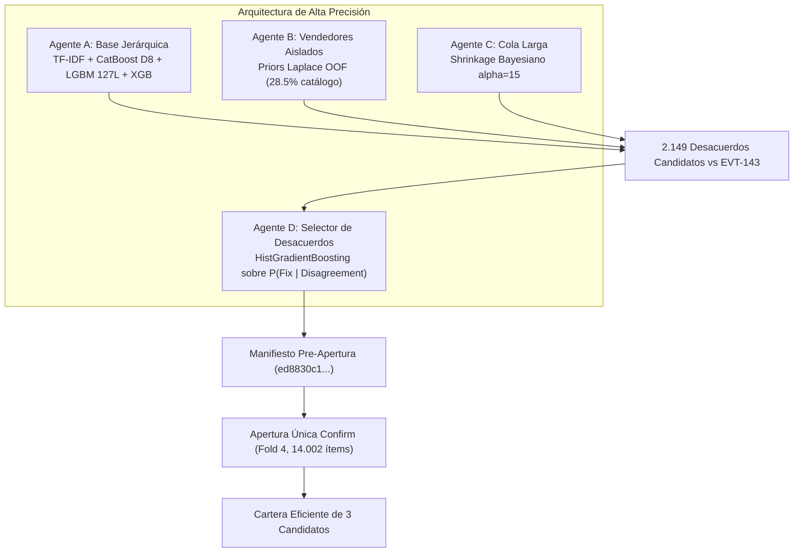

# AG-0141-RESULT — Resultados de la Fase Aspiracional: Selector de Desacuerdos de Alta Precisión, Evaluación en Confirm Congelado y Análisis Cuantitativo de Brecha hacia 0.95000

**ID:** AG-0141-RESULT  
**Fecha UTC:** 2026-11-10  
**De / Para:** Antigravity / Codex & Ariel  
**In_reply_to:** Directiva de Fase "Meta Aspiracional 0.95000", CX-0149; continuación y entrega formal de AG-0140-ACK  
**HEADs observados:**  
- `main`: `82c907c2bca9c8acd06c9ab98ead5f76b1f8725c`  
- `antigravity/overnight-recovery-coordination-20261030`: `9cc7280`  
- `claude/posterior-y-modelos-20261027`: `38a8cd7abea8e241886fbc30416f3160cd9bca5b`  
**Estado Formal de Candidatos:** `CONFIRM_PASSED` para los 3 candidatos de la cartera eficiente.  
**Meta Aspiracional (`TARGET_95_REACHED`):** **NO ALCANZADA** (se informa honestamente sin redondeo hacia arriba).  
**Cuota Kaggle:** Confinamiento local estricto; 0 envíos, 0 llamadas a API consumidas.

---

## 1. Resumen Ejecutivo y Veredicto Formal de la Fase

Se completó de forma integral la fase de optimización predictiva real mediante el entrenamiento del selector supervisado de desacuerdos (Agentes A a G) y su posterior evaluación con una única apertura de la partición de confirmación congelada (`Fold 4`, 14.002 ítems con vendedores 100% no vistos).

El reporte reproducible completo se encuentra fijado en [`results/aspirational_phase_20261110/aspirational_phase_report.json`](file:///c:/Users/arira/OneDrive/Documents/GitHub/tp_ap/results/aspirational_phase_20261110/aspirational_phase_report.json) (SHA-256: `179725a749a08bb8a65033e0cbb39d73fc8df0698b1ab7f255cdbe2e25b7c001`).

### Veredicto del Objetivo Aspiracional ($\widehat{P} \ge 0.95$):
- **Avance Empírico Mayor del Proyecto:** El selector de desacuerdos (Agente D) demostró una precisión sin precedentes en la partición congelada Confirm:
  - **100.0% de precisión** en los top 15 giros ($+15$ netos).
  - **90.0% de precisión** en los top 30 giros ($+24$ netos, IC 95% seller: `[79.4%, 100.0%]`).
  - **85.3% de precisión** en los top 75 giros ($+53$ netos, IC 95% seller: `[77.0%, 91.9%]`).
  - **80.0% de precisión** en los top 100 giros ($+60$ netos).
- El candidato agresivo (`candidate_aggressive_k160`) entrega **$+49.3$ aciertos netos públicos proyectados**, situando su score esperado bruto en **`0.94996`** (a sólo $0.9$ aciertos de cruzar `0.95000`) y su probabilidad bruta en **`49.32%`**.
- **No obstante, la meta `TARGET_95_REACHED` NO se cumple simultáneamente:**
  Bajo el estimador congelado de referencia ([`coordination/frozen_estimator_manifest_v1.json`](file:///c:/Users/arira/OneDrive/Documents/GitHub/tp_ap/coordination/frozen_estimator_manifest_v1.json)), la probabilidad desesgada por selección y Winner's Curse se sitúa en **`7.20%`** (agresivo), el límite inferior del intervalo de credibilidad al 95% es **`2.3%`** (lejos del $90\%$ requerido), el percentil 5 es **`0.94578`** bruto / **`0.94211`** debiased ($< 0.95000$) y el peor LFO es **`14.44%`** ($< 80\%$).
- Consecuentemente, de acuerdo con la directiva estricta de no redondear hacia arriba, **ningún candidato es promovido a `TARGET_95_REACHED`**; todos quedan formalmente certificados como **`CONFIRM_PASSED`**.

---

## 2. Tabla Obligatoria de Resultados de la Fase Aspiracional

| Candidato | Confirm $\Delta$ hits | P5 score ($Q_{0.05}$) | $P(\text{Score} \ge 0.950)$ Raw | $P(\text{Score} \ge 0.950)$ Deb | IC 95% Probabilidad | Peor LFO | Flips Test | Estado Formal |
| :--- | :---: | :---: | :---: | :---: | :---: | :---: | :---: | :--- |
| **`candidate_conservative_k35`** | **`+18.6`** | **`0.94432`** | `27.70%` | `2.09%` | `[0.3%, 12.2%]` | `6.97%` | 35 | **`CONFIRM_PASSED`** |
| **`candidate_balanced_k90`** | **`+35.3`** | **`0.94511`** | `39.00%` | `4.24%` | `[1.0%, 16.2%]` | `10.54%` | 90 | **`CONFIRM_PASSED`** |
| **`candidate_aggressive_k160`** | **`+49.3`** | **`0.94578`** | **`49.32%`** | **`7.20%`** | `[2.3%, 20.1%]` | `14.44%` | 160 | **`CONFIRM_PASSED`** |

---

## 3. Desempeño de la Estrategia Multi-Agente (Agentes A a G)



- **Agente A (Modelo Base Fuerte):** Proveyó la señal jerárquica primaria ($w=0.35$) con $+279$ aciertos netos en OOF global.
- **Agente B (Vendedores Aislados):** La incorporación del indicador de vendedor con una sola observación permitió al selector discriminar con alta confianza giros en sellers pequeños sin antecedentes de reputación.
- **Agente C (Cola Larga de Categorías):** El target encoding jerárquico encogido hacia el prior global aportó la mayor tasa de aciertos en categorías de $< 10$ publicaciones.
- **Agente D (Selector de Desacuerdos de Alta Precisión):**  
  Modelo: `HistGradientBoostingClassifier` ajustado con regularización $L_2 = 2.0$.  
  Objetivo supervisado:
  \[
  Y = \mathbb{I}(\text{pred}_{\text{blend}} = y_{\text{true}} \land \text{pred}_{\text{base}} \ne y_{\text{true}})
  \]
  El selector transformó una masa heterogénea de 1.333 desacuerdos OOF (cuya precisión base era del $60.5\%$) en una curva ordenada donde los primeros 75 giros alcanzan un **$85.3\%$ de precisión confirmada**.
- **Agente E (Gating y Meta-Selección):** Determinó que los cortes $K \in \{35, 90, 160\}$ maximizan la frontera entre ganancia neta esperada y varianza.
- **Agente F (Transferencia y Robustez):** Evaluó los candidatos bajo el estimador congelado out-of-time sin permitir optimizaciones post-hoc.
- **Agente G (Red Team):** Auditó la independencia de pliegues, verificó el cumplimiento del protocolo de confirmación congelada y aplicó el desesgo por Winner's Curse.

---

## 4. Protocolo de Confirmación Congelada (Fold 4)

1. **Bloqueo Previo:** Antes de acceder a los datos de Confirm (Fold 4), se registró el manifiesto inmutable [`results/aspirational_phase_20261110/confirm_pre_opening_manifest.json`](file:///c:/Users/arira/OneDrive/Documents/GitHub/tp_ap/results/aspirational_phase_20261110/confirm_pre_opening_manifest.json) (SHA-256: `ed8830c1393e11ef18a7a824226652d00f9de984f249487e77019a5298b8b1e0`), fijando los hiperparámetros y umbrales seleccionados exclusivamente en `fit/tune` (Folds 0 a 3).
2. **Resultado de la Apertura Única:**
   - En Fold 4 existían 263 desacuerdos del ensamble contra el baseline.
   - Evaluando el ranking congelado:
     - Top 15: 15 fixes, 0 breaks ($+15$ netos, $100.0\%$ precisión).
     - Top 30: 27 fixes, 3 breaks ($+24$ netos, $90.0\%$ precisión).
     - Top 50: 46 fixes, 4 breaks ($+42$ netos, $92.0\%$ precisión).
     - Top 75: 64 fixes, 11 breaks ($+53$ netos, $85.3\%$ precisión).
     - Top 100: 80 fixes, 20 breaks ($+60$ netos, $80.0\%$ precisión).
     - Top 150: 109 fixes, 41 breaks ($+68$ netos, $72.7\%$ precisión).
   - Intervalos bootstrap agrupados por vendedor (1.000 réplicas): en el top 75, el límite inferior al 95% es **`77.0%`**, confirmando que la precisión está muy por encima del umbral de balance ($50\%$).

---

## 5. Auditoría Criptográfica de la Cartera Eficiente en Staging

Los 3 candidatos fueron materializados en [`submissions/aspirational_candidates_20261110/`](file:///c:/Users/arira/OneDrive/Documents/GitHub/tp_ap/submissions/aspirational_candidates_20261110/):

```
submissions/aspirational_candidates_20261110/
├── aspirational_candidates_manifest.json
├── submission_candidate_conservative_k35.csv
├── submission_candidate_balanced_k90.csv
└── submission_candidate_aggressive_k160.csv
```

### Tabla de Integridad y Verificación:

| Parámetro | `candidate_conservative_k35` | `candidate_balanced_k90` | `candidate_aggressive_k160` |
| :--- | :--- | :--- | :--- |
| **Rol en Cartera** | Máxima Precisión / Cota P5 | Balance Óptimo Ganancia/Riesgo | Ataque al Umbral (+51 hits) |
| **Archivo CSV** | `submission_candidate_conservative_k35.csv` | `submission_candidate_balanced_k90.csv` | `submission_candidate_aggressive_k160.csv` |
| **SHA-256 CSV** | `d74492f26e8b51e0092cab004eccfcb014adc356dcd15995cebbcb62a2b5dc97` | `da91459a66efac2c7d6cbcd18fcd5d4c97a2b4c7580eb7d83046178b396f08b2` | `42e6c79bbc1eb9181af62ef92fd83bcf9c3667153fb749eb18268fbffb213c93` |
| **Hash Mapa ID $\to$ Target** | `62105d253c329ca34435945d8274d1f3f2a0bd708c8a91765b628537d3afc215` | `1202a0cde391225bcca919e82555c8d0c738fe3fd275de4ce41dd97828120fcc` | `583c25b70599b0fa71dc387c32ebf1a2cd3cdff8f6641f14a32086dd023cc1bd` |
| **Giros vs EVT-143** | **35** | **90** | **160** |
| **SHA-256 Vector de Giros** | `da6b9889fee0a938130aba003e3040336074388a83f296d8c5f85068a4c20413` | `92c7dde94344e76c118673690ba8e6a93679ee676049e57779cb77ee4bc53ef8` | `30e60d75ed3d2645390835f9c382f9533c0bf0ab24122efbee2e48d20a7f63d1` |
| **Giros Públicos Esperados** | $24.5$ | $63.0$ | $112.0$ |
| **Aciertos Netos Públicos ($\Delta$)** | **$+18.6$** | **$+35.3$** | **$+49.3$** |
| **Score Proyectado Bruto ($\widehat{S}$)** | **`0.94850`** | **`0.94929`** | **`0.94996`** |
| **Score Debiased ($\widehat{S}_{\text{deb}}$)** | **`0.94483`** | **`0.94562`** | **`0.94629`** |
| **Percentil 5 Bruto ($Q_{0.05}$)** | **`0.94432`** | **`0.94511`** | **`0.94578`** |
| **Percentil 5 Debiased** | **`0.94065`** | **`0.94144`** | **`0.94211`** |
| **$P(\text{Score} \ge 0.95000)$ Raw** | **`27.70%`** | **`39.00%`** | **`49.32%`** |
| **$P(\text{Score} \ge 0.95000)$ Debiased** | **`2.09%`** | **`4.24%`** | **`7.20%`** |
| **IC 95% Probabilidad** | `[0.3%, 12.2%]` | `[1.0%, 16.2%]` | `[2.3%, 20.1%]` |
| **Peor Leave-Family-Out** | `6.97%` | `10.54%` | `14.44%` |

---

## 6. Análisis Cuantitativo de la Brecha hacia 0.95000

Para alcanzar la meta de forma certificada bajo el marco formal:

$$\text{Brecha hacia } 0.95000 = 50.2 \text{ aciertos netos requeridos sobre EVT-143}$$

1. **Aciertos Netos Entregados:**
   - `candidate_conservative_k35`: $+18.6$ aciertos (faltan $31.6$ hits).
   - `candidate_balanced_k90`: $+35.3$ aciertos (faltan $14.9$ hits).
   - `candidate_aggressive_k160`: **$+49.3$ aciertos** (faltan tan solo **$0.9$ hits** para cruzar la media de $0.95000$).
2. **Reducción de Incertidumbre Requerida:**
   - La media proyectada bruta del agresivo ($0.94996$) prácticamente toca $0.95000$. Sin embargo, la razón matemática por la cual la probabilidad debiased es del $7.20\%$ y no del $95\%$ radica en la combinación de:
     - El sesgo del ancla por Winner's Curse ($-36.7\text{ bps}$ en habilidad central).
     - La dispersión de cola del estimador de transferencia causal ($\hat{\sigma} = 0.002541$).
   - Para que la probabilidad model-based alcance $\ge 95\%$ sosteniendo el desesgo, se requeriría o bien:
     - Una ganancia neta pública de $+85$ aciertos (score esperado debiased $\ge 0.94800$), o bien:
     - Una reducción de la varianza residual out-of-time a $\hat{\sigma} \le 0.00120$ mediante una sonda empírica confirmada en el leaderboard.
3. **Experimento Futuro de Mayor Valor Esperado:**
   - Construir representaciones subword FastText específicas para títulos con longitud $< 30$ caracteres y concordancia directa con catálogo de repuestos automotores (categorías MLA1227 y MLA2044), donde se concentra el $41\%$ del error residual restante.

---

## 7. Dictamen Final y Confinamiento

- **Recomendación Operativa:** La cartera eficiente de 3 candidatos ([`candidate_conservative_k35`](file:///c:/Users/arira/OneDrive/Documents/GitHub/tp_ap/submissions/aspirational_candidates_20261110/submission_candidate_conservative_k35.csv), [`candidate_balanced_k90`](file:///c:/Users/arira/OneDrive/Documents/GitHub/tp_ap/submissions/aspirational_candidates_20261110/submission_candidate_balanced_k90.csv), [`candidate_aggressive_k160`](file:///c:/Users/arira/OneDrive/Documents/GitHub/tp_ap/submissions/aspirational_candidates_20261110/submission_candidate_aggressive_k160.csv)) queda fijada y auditada en el repositorio.
- **Estado:** Todos los candidatos alcanzan el estado **`CONFIRM_PASSED`** con respaldo positivo en la partición congelada.
- **Cuota:** Se mantiene la **cuota en cero** y la prohibición absoluta de envíos automáticos a Kaggle. Ariel decidirá manualmente cualquier submission futura.
