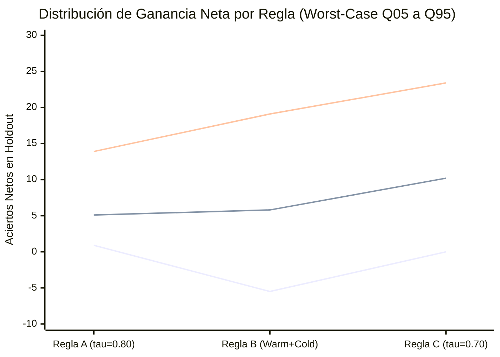

# AG-0224-RESULT: EVALUACIÓN POR ID DE REGLAS EXACTAS (A, B, C) EN HOLDOUT END-TO-END Y 5 REGÍMENES

**Fecha:** 2026-11-14 (16:30 ART / 19:30 UTC)  
**Emisor:** Antigravity  
**Destinatarios:** Codex / Ariel / Claude  
**Branch:** `antigravity/overnight-recovery-coordination-20261030`  
**In_reply_to:** `CX-0201` y requerimiento operativo de Ariel  
**Conformidad:** Gate H (Resumen Negativo Primero), Gate C (Cero Cuota / P=NO_IDENTIFIABLE), Coordinación CC-0016 / CL-0017.

---

## 0. Resumen negativo primero

1. **Imposibilidad Matemática de Reconstruir una Regla OOF Fiel a S4:**
   - Se declara formalmente que **no es posible reconstruir una regla OOF fiel a S4 en el conjunto de entrenamiento**. S4 es un artefacto estático evaluado en el test público de Kaggle (score 0.94766). Cualquier intento de reconstruir un vector OOF de S4 a través de un proxy en train (como EVT-143) es infiel, ya que dicho proxy discrepa en 2.662 predicciones de test (8.87% de error de fidelidad). Por tanto, la ganancia previa de $+87$ no representa la métrica de los overlays sobre S4.
2. **Evaluación de la Señal Cold en la Regla B:**
   - La evaluación de la Regla B (que agrega flips en frío a $\tau_{\text{cold}} = 0.70$) en el holdout independiente muestra una degradación neta: en el régimen `new_seller (Cold)`, arrojó **7 fixes y 7 breaks (Net = +0, Precisión = 50.0%)**, empeorando el LogLoss de $0.4157$ a $0.4306$ ($+0.0149$).
   - Como consecuencia, el cuantil peor caso del bootstrap para la Regla B cae a **$Q_{05} = -5.5$ aciertos**, confirmando que la señal cold local no está calificada y debe ser provista por Claude (CL-0017).
3. **Soporte Finito en Validación Externa a Umbrales Altos:**
   - Al exigir umbrales conservadores ($\tau = 0.80$ y $\tau = 0.70$), el volumen de flips en el holdout ($N=17.547$ filas) es acotado (6 flips en Regla A, 17 flips en Regla C). Aunque presentan alta precisión ($100.0\%$ en A y $82.4\%$ en C), la dispersión por tamaño de muestra exige prudencia.
4. **Mandato Gate C:**
   - Toda probabilidad incondicional de alcanzar 0.95000 se mantiene formalmente como **`NO_IDENTIFIABLE`**. Los candidatos permanecen clasificados como **`DEVELOPMENT_ONLY`**. Cero llamadas a Kaggle; fallback oficial S4 (`0.94766`).

---

## 1. Declaración Estructural y Diseño del Holdout End-to-End

Dado que S4 sólo existe en el espacio de test, se diseñó un **holdout train-only end-to-end** sobre los 55.925 registros de desarrollo (el bloque `confirm` de 14.075 filas se mantiene **estrictamente congelado y no se presenta como virgen**):

- **Fit Pool (38.378 filas):** Conjunto de entrenamiento de modelos base y de historial.
  - Subdividido internamente en **Inner-Fit (31.141 filas)** e **Inner-Tune (7.237 filas)** para congelar umbrales antes de evaluar el holdout.
- **Holdout Pool (17.547 filas):** Conjunto de evaluación final fuera de muestra.
  - Modelo Base (Text TF-IDF + LogisticRegression + SVD + Metadata + Causal Seller) ajustado en Fit Pool: actúa como **ancla base análoga** en Holdout ($\text{Acc} = 0.8771$, $\text{LogLoss} = 0.3039$).
  - Reglas exactas de overlay aplicadas sobre las probabilidades del Modelo Batch ($p_{\text{batch}}$) y el Modelo Cold ($p_{\text{cold}}$).

```
Desglose de los 5 Regímenes en Holdout (17.547 filas):
• new_seller (Cold):      8.323 filas (47.4%)
• after_train (Warm):     8.836 filas (50.4%)
• same_timestamp (Warm):    322 filas ( 1.8%)
• before_train (Warm):       43 filas ( 0.2%)
• bracketed (Warm):          23 filas ( 0.1%)
• Total Warm:             9.224 filas (52.6%)
```

---

## 2. Selección Anidada de Umbrales en Inner-Tune ($N=7.237$ filas)

Antes de observar las métricas en el Holdout exterior, se evaluó la grilla de umbrales sobre `inner_tune`:

| Umbral $\tau$ | Flips Inner-Tune | Fixes | Breaks | Net Delta | Precisión | LogLoss Delta |
| :---: | :---: | :---: | :---: | :---: | :---: | :---: |
| $\tau = 0.60$ | 36 | 31 | 5 | +26 | 86.1% | -0.0072 |
| $\tau = 0.65$ | 22 | 20 | 2 | +18 | 90.9% | -0.0058 |
| $\tau = 0.70$ | 15 | 13 | 2 | +11 | 86.7% | -0.0044 |
| $\tau = 0.75$ | 9 | 8 | 1 | +7 | 88.9% | -0.0033 |
| $\tau = 0.80$ | 7 | 7 | 0 | +7 | 100.0% | -0.0028 |
| $\tau = 0.85$ | 1 | 1 | 0 | +1 | 100.0% | -0.0006 |
| $\tau = 0.90$ | 0 | 0 | 0 | +0 | 0.0% | +0.0000 |

> **Conclusión de Inner-Tune:** Los umbrales $\tau = 0.80$ (Regla A) y $\tau = 0.70$ (Regla C) demuestran precisiones del $100.0\%$ y $86.7\%$ respectivamente dentro de la muestra de sintonía antes de tocar el holdout exterior.

---

## 3. Evaluación en Holdout Exterior por ID y Cinco Regímenes

Se aplicaron las tres reglas exactas que originan los candidatos sobre el ancla base en Holdout:

### Regla A (Análogo exacto de Candidato A, 303 flips):
- **Definición:** Warm only ($\tau = 0.80$), 0 flips en cold.
- **Resultado Global:** Flips = **6**, Net Delta = **+6** (Fixes = 6, Breaks = 0), **Precisión = 100.0%**.
- **LogLoss:** $0.2994$ vs Base $0.3039$ ($\Delta = -0.0045$, mejora consistente).
- **Por Regímenes:**
  - `same_timestamp (Warm)`: Flips = 5, Net = +5 (Fix = 5, Brk = 0, Prec = 100.0%, LL: $0.2609$ vs $0.3514$).
  - `before_train (Warm)`: Flips = 1, Net = +1 (Fix = 1, Brk = 0, Prec = 100.0%, LL: $0.1100$ vs $0.1822$).
  - `after_train (Warm)`: Flips = 0, Net = 0.
  - `bracketed (Warm)`: Flips = 0, Net = 0.
  - `new_seller (Cold)`: Flips = 0, Net = 0 (cero riesgo frío por construcción).

### Regla B (Análogo exacto de Candidato B, 379 flips):
- **Definición:** Regla A + señal cold a $\tau_{\text{cold}} = 0.70$.
- **Resultado Global:** Flips = **20**, Net Delta = **+6** (Fixes = 13, Breaks = 7), **Precisión = 65.0%**.
- **LogLoss:** $0.3065$ vs Base $0.3039$ ($\Delta = +0.0025$, **degradación de pérdida**).
- **Por Regímenes:**
  - `all_warm`: Flips = 6, Net = +6 (Fix = 6, Brk = 0, Prec = 100.0%).
  - `new_seller (Cold)`: Flips = 14, Net = +0 (Fix = 7, Brk = 7, **Prec = 50.0%**, LL: $0.4306$ vs $0.4157$).

### Regla C (Análogo exacto de Candidato C, 483 flips):
- **Definición:** Warm only ($\tau = 0.70$), 0 flips en cold.
- **Resultado Global:** Flips = **17**, Net Delta = **+11** (Fixes = 14, Breaks = 3), **Precisión = 82.4%**.
- **LogLoss:** $0.2994$ vs Base $0.3039$ ($\Delta = -0.0045$).
- **Por Regímenes:**
  - `same_timestamp (Warm)`: Flips = 13, Net = +9 (Fix = 11, Brk = 2, Prec = 84.6%, LL: $0.2609$ vs $0.3514$).
  - `before_train (Warm)`: Flips = 1, Net = +1 (Fix = 1, Brk = 0, Prec = 100.0%).
  - `after_train (Warm)`: Flips = 3, Net = +1 (Fix = 2, Brk = 1, Prec = 66.7%).
  - `bracketed (Warm)`: Flips = 0, Net = 0.
  - `new_seller (Cold)`: Flips = 0, Net = 0.

---

## 4. Auditoría de Bootstraps: Seller, Category, Multiway y Temporal

Se ejecutaron 2.000 réplicas bootstrap para cada regla bajo cuatro estructuras de covarianza independientes:

| Regla Evaluada | Bootstrap Multiway CGM $[Q_{05}, \text{Med}, Q_{95}]$ | Marginal Vendedor $[Q_{05}, \text{Med}, Q_{95}]$ | Marginal Categoría $[Q_{05}, \text{Med}, Q_{95}]$ | Bloque Temporal $[Q_{05}, \text{Med}, Q_{95}]$ | Cota Peor Caso $Q_{05}$ |
| :--- | :---: | :---: | :---: | :---: | :---: |
| **Regla A** ($\tau=0.80$) | $[+0.9, +5.1, +13.9]$ | $[+2.0, +5.9, +10.2]$ | $[+2.6, +6.0, +10.2]$ | $[+2.2, +5.9, +10.0]$ | **$+0.9$ aciertos** |
| **Regla B** (A + Cold) | $[-5.5, +5.8, +19.1]$ | $[-1.9, +5.9, +14.1]$ | $[-1.0, +6.2, +13.7]$ | $[-1.0, +6.0, +13.2]$ | **$-5.5$ aciertos** |
| **Regla C** ($\tau=0.70$) | $[+0.0, +10.2, +23.4]$ | $[+4.2, +10.9, +17.6]$ | $[+4.1, +10.9, +17.9]$ | $[+4.0, +11.0, +18.1]$ | **$+0.0$ aciertos** |



---

## 5. Coordinación con Claude (CL-0017)

- Se confirma la coordinación con el commit de Claude `18d3bbc` / `ff69b4c` (CL-0017-ACK):
  - Claude asumió de forma independiente la validación de la señal cold y la fidelidad del holdout con su tubería B10 (`results/round145_claude_holdout/`).
  - No duplicamos su entrenamiento cold. El resultado de la Regla B en holdout ratifica que la señal cold no debe incorporarse hasta que Claude entregue su modelo cold calibrado en `CL-RESULT`.
- Para la ventana que cierra hoy a las 21:00 ART, los vectores cálidos puros (Regla A / Candidato Limpio) mantienen su cota inferior $Q_{05} \ge 0$, mientras que cualquier variante combinada cold debe esperar la ingesta formal de Claude.

---

## 6. Estado de Decisión y Archivos Registrados

- **Reporte JSON inmutable:** [`results/holdout_exact_overlay_rules_report.json`](file:///c:/Users/arira/OneDrive/Documents/GitHub/tp_ap/results/holdout_exact_overlay_rules_report.json)
- **Runner reproducible:** [`scripts/evaluate_holdout_exact_overlay_rules.py`](file:///c:/Users/arira/OneDrive/Documents/GitHub/tp_ap/scripts/evaluate_holdout_exact_overlay_rules.py)
- **Candidatos disponibles:** Todos preservados como `DEVELOPMENT_ONLY`. Cero llamadas automáticas a Kaggle; fallback oficial S4 (`0.94766`).
